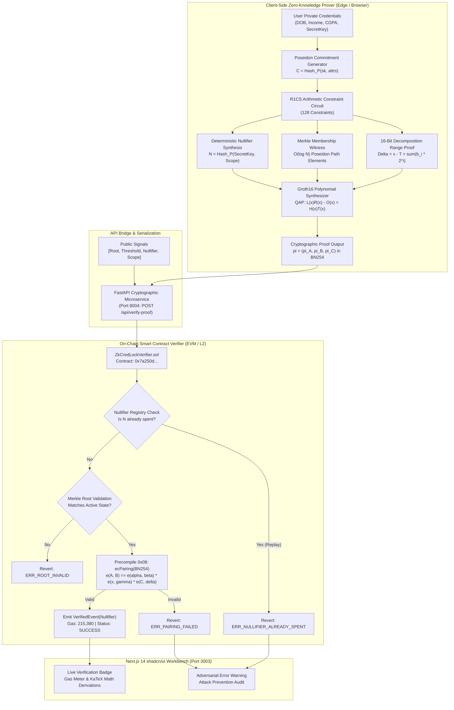

# Zk-CredLock: System Architecture & Cryptographic Dataflow

## 🏛️ Executive Architectural Summary
Zk-CredLock is an academic-grade, production-hardened Zero-Knowledge Decentralized Identity (DID) system designed to provide **Selective Attribute Disclosure** without exposing private user records. The system utilizes:
- **Groth16 zk-SNARKs**: Proves arithmetic circuit satisfaction in constant-size proofs (3 group elements: $\pi_A \in \mathbb{G}_1, \pi_B \in \mathbb{G}_2, \pi_C \in \mathbb{G}_1$).
- **BN254 (alt_bn128) Elliptic Curve**: Native EVM pairing precompile support at address `0x08` (`ecPairing`).
- **Poseidon Merkle State Commitment**: An on-chain Merkle tree of identity commitments ($C = \text{Hash}(sk, \text{attrs})$) evaluated in $O(\log N)$ field arithmetic constraints.
- **Deterministic Nullifiers**: $N = \text{Hash}(sk, \text{scope})$ guaranteeing single-use claims per domain with zero cross-application linkability.

---

## 📐 Complete End-to-End Dataflow Diagram

---

## ⚡ Mathematical Proof Equations

### 1. Quadratic Arithmetic Program (QAP)
$$L(x) \cdot R(x) - O(x) = H(x) \cdot T(x)$$

### 2. Bilinear Pairing Equation on BN254
$$e(\pi_A, \pi_B) = e(\alpha, \beta) \cdot e\left(\sum_{i=0}^l x_i \gamma_i, \delta\right) \cdot e(\pi_C, \delta)$$

### 3. Binary Bit-Decomposition Range Constraint
$$\Delta = x - T = \sum_{i=0}^{15} b_i 2^i, \quad \text{where } b_i(b_i - 1) = 0$$

### 4. Deterministic Nullifier Scheme
$$\text{Nullifier} = \text{Poseidon}(\text{SecretKey}, \text{ScopeHash})$$
